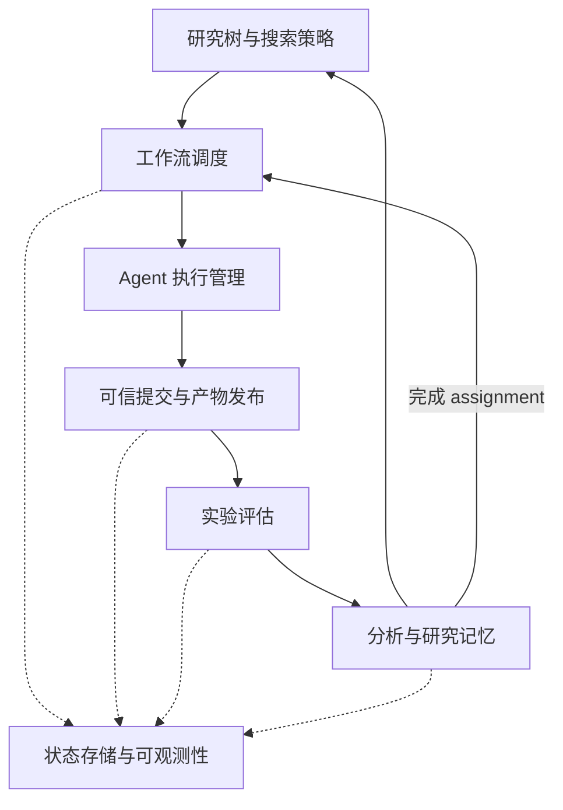

# CORAL × GreedyLoRE AutoResearch 架构

本文描述当前仓库中 GreedyLoRE AutoResearch 的实现，按职责划分为七个逻辑模块，说明各模块的输入、输出、代码位置和协作边界。这些模块并非七个独立部署的服务；部分职责由同一文件承担。

## 1. 总体结构

CORAL 提供 Agent 进程管理、Git worktree、评分队列、沙箱、共享状态和查询界面。GreedyLoRE 在此基础上增加研究树、任务状态机、Researcher / Engineer 分工、固定评估协议，以及独立分析和全局记忆。

任务配置入口是 [task.yaml](../tasks/greedylore_autoresearch/task.yaml)。任务专用的工作流实现在可独立安装的 [autoresearch 包](../tasks/greedylore_autoresearch/autoresearch/pyproject.toml)中；CORAL 核心通过 dynamic assignment 和可信命令接口接入它。

| 模块 | 核心问题 | 主要输出 |
| --- | --- | --- |
| 研究树与搜索策略 | 下一步研究什么、从哪个 Parent 出发？ | Node Spec、Parent 和代码基点 |
| 工作流调度 | 谁在何时执行哪个 assignment？ | assignment roster、生命周期状态 |
| Agent 执行管理 | 如何启动、隔离、恢复和停止 Agent？ | Agent 进程、worktree、Session 日志 |
| 可信提交与产物发布 | 谁可以提交或发布什么？ | 经校验的 Attempt 和共享产物 |
| 实验评估 | 候选是否满足质量要求、效率如何？ | ScoreBundle、原始测量和评估证据 |
| 分析与研究记忆 | 结果说明什么、下一轮应知道什么？ | Evaluation、版本化 Analysis、Summary |
| 状态存储与可观测性 | 如何保存、追溯和展示整个过程？ | 持久状态、实验历史、CLI 和 Dashboard 视图 |



## 2. 研究树与搜索策略

该模块把实验组织成有显式 Parent 的研究节点。每个 Node 对应一个算法假设，Spec 记录 Parent、固定代码基点、选点理由、改动、风险和证伪条件。节点内部的实现过程与研究树上的一次扩展是不同概念。

运行从固定 Root `N000` 开始。Root bootstrap 建立来源信息、基线 Attempt 和 Research Analysis；动态调度在创建后续任务前会验证这些证据。普通 Researcher 获得系统分配的 Node ID 后，自主选择已完成且有有效 Research Analysis 的 Parent，再调用 `autoresearch node initialize` 固定 Spec 和基点。

Parent 选择考虑预期收益或信息价值、已有证据、探索程度、验证成本和质量风险。当前没有集中式 UCT / MCTS 选点公式，也不强制从最高分节点扩展。质量失败仍可产生 Research Analysis，后续 child 可以研究修复或新假设。

输入是现有 Tree、Spec、Evaluation、Analysis 和代码快照；输出是新节点的研究定义。Engineering 在原 Node 上增加实现优化结果，不替换 Research 成果，也不创建新的研究树节点。Child 的代码基点取 Parent 的固定 Research SHA，Engineering Analysis 可以作为选点参考。

主要代码：[nodes.py](../tasks/greedylore_autoresearch/autoresearch/src/autoresearch/nodes.py)、[state.py](../tasks/greedylore_autoresearch/autoresearch/src/autoresearch/state.py)、[researcher.md](../tasks/greedylore_autoresearch/roles/researcher.md)。

## 3. 工作流调度

任务级调度器是 `WorkflowStore`。它管理节点预留、Research assignment、Engineering reservation / claim、完成条件和编号分配。当前配置允许最多两个 Researcher 和一个 Engineer；容量由 `task.yaml` 指定。

CORAL Manager 周期性请求 `reconcile_workflow`。可信服务调用任务的 `handle_workflow()`，由 `WorkflowStore.reconcile()` 返回期望的 assignment roster。Manager 将 roster 与实际 Agent 对照，创建缺失的 Agent，保留存续者，并停止进入 finalizing 或已结束的生产 Agent。

对 Manager 而言，活跃 assignment 的主要阶段是 `reserved → active → finalizing`；完成后不再出现在所需 roster 中。finalizing 表示任务已请求收尾，禁止继续提交候选，宿主负责生成分析并完成状态转换。Research 在唯一正式 Attempt 已终态且没有剩余基础设施重试时自动收尾；Engineering 由 `autoresearch engineering finish` 发起收尾。

因此，调度分为三层：GreedyLoRE 决定研究 assignment，CORAL Manager 管理执行进程，grader daemon 管理评估队列。普通模式的固定长期 Agent 循环被 dynamic 分支替代，但进程管理和评分队列仍复用 CORAL。

主要代码：[state.py](../tasks/greedylore_autoresearch/autoresearch/src/autoresearch/state.py)、[lifecycle.py](../tasks/greedylore_autoresearch/autoresearch/src/autoresearch/lifecycle.py)、[dynamic.py](../coral/agent/dynamic.py)、[manager.py](../coral/agent/manager.py)。

## 4. Agent 执行管理

该模块将 assignment 转成实际运行环境。CORAL 为 Agent 建立独立 Git worktree，配置虚拟环境、共享目录链接、运行时设置和沙箱，再启动 Codex 等外部 CLI 子进程。动态 assignment 只提供身份、角色、Node 和状态；运行时和角色文件来自宿主配置。

Researcher 负责一个算法假设和一个正式 Research 候选。Engineer 原子认领一个合格节点，从该节点固定 Research SHA 出发进行语义保持优化。Engineer 的角色规则规定每次认领最多两轮正式候选；提示词规则与服务端硬约束需要分别看待。

dynamic 模式生成精简的任务专用指令，指向对应角色文件。当前 Codex runtime 将其写为 worktree 根目录的 `AGENTS.md`，不会加载通用长版 `CORAL.md` 模板。角色文件再指引 Agent 阅读共享工作流规则。

进程异常退出时，Manager 尝试恢复相同身份与 Session；节点完成后则退休原生产 Agent，后续节点启动新身份。当前任务关闭通用 heartbeat。独立 Analyzer 使用新会话，不属于生产 Researcher / Engineer 的持续对话；受控诊断模式使用按 Node/mode/version 固定的独立 workspace，未启用时保留原临时目录模式。

主要代码：[manager.py](../coral/agent/manager.py)、[codex.py](../coral/agent/builtin/codex.py)、[project.py](../coral/workspace/project.py)、[worktree.py](../coral/workspace/worktree.py)、[coral_md.py](../coral/template/coral_md.py)、[角色规则](../tasks/greedylore_autoresearch/roles/workflow_rules.md)。

## 5. 可信提交与产物发布

该模块连接 Agent 的请求与宿主持有的权威状态。Agent 在自己的 worktree 中编辑代码，通过 `coral eval` 提交候选，通过 `autoresearch` 命令初始化节点、认领任务、请求收尾或发布产物。

可信服务通过本地 Unix socket 接收命令，结合调用进程身份和宿主登记的 Agent 信息确定归属。任务校验器读取固定 commit 中的 `submission.yaml`，检查 Node、mode、基点、quality anchor、证据引用等；授权器检查当前 assignment 及其是否已进入 finalizing。Research 同一节点的不同正式候选 SHA 也在提交入口受到限制。

Spec、Evaluation、Analysis 和 Summary 等产物经过目标路径和内容校验后发布。私有状态和评估数据由宿主持有，Agent 不直接修改权威 Tree 或原始评分记录。同 SHA 的基础设施故障使用 retry 路径，保留运行证据；算法或候选失败作为研究结果保留。

这部分不仅依赖提示词。`task.yaml` 中的 `trusted_workflow_*`、`trusted_submission_validator`、`trusted_artifact_*` 和 `trusted_memory_*` 入口将具体规则交给任务包，在可信执行环境中运行。

主要代码：[trusted_writes.py](../coral/grader/trusted_writes.py)、[trusted_worker.py](../coral/grader/trusted_worker.py)、[post_commit.py](../coral/hooks/post_commit.py)、[submission.py](../tasks/greedylore_autoresearch/autoresearch/src/autoresearch/submission.py)、[artifacts.py](../tasks/greedylore_autoresearch/autoresearch/src/autoresearch/artifacts.py)、[client.py](../tasks/greedylore_autoresearch/autoresearch/src/autoresearch/client.py)。

## 6. 实验评估

CORAL grader daemon 发现 pending Attempt 后，在对应 commit 的独立 detached worktree 中执行评分。评分程序通过独立 grader 虚拟环境加载，避免生产 Agent 后续编辑影响已提交候选。当前任务设置一个评估 worker，因此正式评估串行执行。

任务 grader 解释固定 `eval_contract.yaml`，组织训练质量检查和四卡效率测量。`gpu.py` 探测和预留 GPU，并校验 GPU 型号、拓扑、NUMA 和 NCCL 环境的可比性；`process.py` 管理评估子进程；`quality.py` 和 `efficiency.py` 构造固定命令。

当前探索预算：60M AdamW 保留 8,393 步学习率调度，只训练 4,000 步；130M Muon 保留 20,000 步调度，只训练 2,500 步。两项 Quality 均比较训练结束时的 validation loss（`final_eval_loss`），不使用 training loss、历史最低 loss 或 PPL 替代。Dense 对照必须采用相同截断步数和调度；修改预算会改变 contract hash，旧 8,393 步的 60M 基线不能直接复用为 4,000 步基线。这是短预算探索证据，不代表完整训练的最终质量。Timing 协议不变。

当前 Quality 门槛为两项 workload 的 final validation loss 均不超过对应 Dense 的 1.06 倍（最多退化 6%）；评分器读取 Contract 中的 `quality.max_relative_eval_loss`。门槛也参与 Contract hash，不能覆盖或重标此前 10% 门槛下的 Attempt 与 Dense 记录。角色和运行时提示使用英文；Analysis 仍保存为 schema 约束的 JSON，UTF-8 文本不转义非 ASCII 字符。

Research 模式同时评估质量与效率。质量门槛失败时，汇总分数为零；效率使用 BF16、FP32 相对 dense 基线加速比的几何平均。Engineering 模式只执行效率评估，质量指标标为 `inherited (provisional)`，不代表重新实测。硬件不可比时不产生有效汇总效率分数。

输出包括 `ScoreBundle`、反馈、失败类别、协议 hash、硬件信息和原始日志。持久证据写入专门的评估日志目录；评分 checkout 会被清理，不适合作为长期产物存储位置。

主要代码：[daemon.py](../coral/grader/daemon.py)、[subprocess_grader.py](../coral/grader/subprocess_grader.py)、[任务 grader](../tasks/greedylore_autoresearch/grader/src/greedylore_autoresearch_grader/grader.py)、[gpu.py](../tasks/greedylore_autoresearch/grader/src/greedylore_autoresearch_grader/gpu.py)、[固定协议](../tasks/greedylore_autoresearch/taskdata/eval_contract.yaml)。

## 7. 分析与研究记忆

该模块将评分证据转成下一轮可使用的知识。`evaluation.py` 从正式 Attempts 和原始日志重建 Node 的 `evaluation.md`；它是确定性的结果索引，包含失败和退化结果，不只展示最佳候选。

`lifecycle.py` 驱动自动收尾，准备固定证据并调用 `analysis.py`。独立 Analyzer 使用新会话，读取指定 SHA 的代码快照、Spec、Evaluation、相关 Analysis 和原始证据，根据 research / engineering 专用 prompt 输出结构化正文。宿主补入固定证据封装，校验后发布版本化 Analysis。

Research Analysis 关注质量变化、算法机制、竞争解释、局限和可证伪的 child 建议。Engineering Analysis 关注结构开销、可优化实现开销及尚未证实的性能归因，同时审视全部工程候选。有效 Research Analysis 是节点完成和后续扩展的关键条件，Research 不必等待 Engineering。

### Analyzer 诊断实验

关键证据不足时，Analyzer 可在同一 Session 中编写小型诊断脚本，通过权威入口申请 GPU；它不是正式 Attempt，不改变质量、评分或 Engineer 两轮规则：

```bash
autoresearch diagnostic run --gpus 4 --timeout 300 -- \
  python experiments/probe.py --output results/probe.json
```

每个分析版本最多实际执行 3 次，每次按需申请 1–4 卡、运行最多 300 秒，排队最多 300 秒。排队失败不消耗执行次数；重复使用 `--request-id <原ID>` 查询同一请求不会再执行。失败、超时和退出码也被记录。重启同一分析版本不重置预算，正式 Analysis 已发布时仍直接复用。

工作区位于 `.coral/public/diagnostics/<Node>-<mode>-v<version>/workspace/`。只有 `experiments/` 和 `results/` 可写，固定 `code/`、`evidence/` 只读；兄弟任务、私有状态和未分配 GPU 不挂载。取得 GPU 后冻结可写输入，实验执行冻结副本，仍使用原来的命令和 workspace 路径，避免排队期间的修改污染证据。结果安全合并拷回 workspace，具体归因以本次持久记录为准。`records/<request-id>/` 保存脚本和输入快照、命令、固定证据身份、GPU、运行时间、stdout/stderr 及结果副本，供 Analysis 引用。每类归档上限 64 MiB / 4096 条目，超出时明确记录归档失败；不承诺完整保留超大输出。普通 Researcher/Engineer 不能改写诊断目录。

启用条件是 `grader.args.analyzer_diagnostics: true`、可用的 bubblewrap namespace，以及显式配置的公共运行依赖。`diagnostic_runtime_roots` 只读挂载所需 Python 环境（含其公开的解释器/链接目标）、CUDA 依赖、本地 C4 和 tokenizer；`diagnostic_path` 指向该环境的 bin 目录。不要挂载整个 home、run、其他 workspace、凭据或 grader 私有环境。它们是宿主配置，不由 Analyzer 请求指定；不会自动安装依赖或下载数据。未安装 bubblewrap 或 namespace 探测失败时保留普通分析并提示诊断未启用；已启用但运行环境不完整时诊断明确失败，不直接在宿主执行命令。

可通过 `analyzer_model` 和 `analyzer_reasoning_effort` 指定诊断 Analyzer 的模型和推理强度。Codex 从可写的 `results/` 启动，并通过 `--add-dir` 获准写 `experiments/`；外层 workspace 根目录及 `code/`、`evidence/` 仍只读。提示中提供 workspace 和固定输入的绝对路径；权威诊断命令仍以 workspace 根目录为工作目录，与 Codex 的初始目录不同。这样避免 Codex 内层 sandbox 在只读根目录创建 `.git`、`.aws` 等保护路径时失败。真实 Codex smoke 已验证读取固定输入、写脚本/结果及拒绝修改证据；该 smoke 不申请 GPU，不能替代 GPU 诊断端到端验证。仅通过 namespace 探针不代表模型工具可用，工具启动失败不得视为有效研究结论。

2026-10-18 的 v5 Analyzer 已可正常读取证据和编写诊断脚本，但本机 Codex 0.160.0 网络过滤器仍拒绝 Unix socket 创建，请求未到达可信服务，实际 GPU 诊断次数为 0。无模型探针显示单路径 Unix socket allow 配置未解除该限制；扩大 Unix socket 授权或直连网络的对照可以连接。尚未将这些权限扩展应用于实际 Analyzer；不能将模型自行写出的请求失败说明当作服务端执行记录。公共 Python 运行时挂载还须包含解释器符号链接的中间路径，不能只挂载最终解析到的版本目录。

现阶段 CPU/可信 socket/预算与回归测试已覆盖；当前开发机缺少 bubblewrap，真实 namespace 隔离、四卡通信及 Codex 在该 namespace 中的运行仍须单独验证，不能仅凭命令构造测试宣称安全性已验证。

`memory.py` 在累计达到条件时整理全局记忆，发布 `research_summary.md` 和 `engineering_summary.md`，并记录所覆盖的 Analysis 引用。Summary 帮助新 Agent 定位证据，具体判断仍需追溯到固定 SHA、Analysis 和原始记录。

主要代码：[evaluation.py](../tasks/greedylore_autoresearch/autoresearch/src/autoresearch/evaluation.py)、[analysis.py](../tasks/greedylore_autoresearch/autoresearch/src/autoresearch/analysis.py)、[memory.py](../tasks/greedylore_autoresearch/autoresearch/src/autoresearch/memory.py)、[research_analysis.md](../tasks/greedylore_autoresearch/prompts/research_analysis.md)、[engineering_analysis.md](../tasks/greedylore_autoresearch/prompts/engineering_analysis.md)。

## 8. 状态存储与可观测性

Artifacts 的完整目录、文件名含义、内容格式、重试和分阶段恢复规则见 [artifacts 组织与保存说明](greedylore-autoresearch-artifacts.md)。该文包含 Quality、Timing、Attempt、Analysis 与诊断归档的示例。

系统以文件和 Git 保存状态，不依赖独立数据库。不同记录承担不同职责：

```text
<run>/
├── repo/                              # 共享 Git 对象与代码历史
├── agents/<agent_id>/                 # 生产 Agent 的独立 worktree
└── .coral/
    ├── private/
    │   ├── autoresearch_state.json    # 权威工作流状态
    │   ├── root_bootstrap.json        # 固定 Root 策略
    │   └── ...                        # grader 环境、私有数据等
    └── public/
        ├── attempts/                  # 正式实验及其运行元数据
        ├── eval_logs/                 # 持久评估证据
        ├── logs/                      # Agent Session 日志
        └── notes/
            ├── tree.md                # 工作流状态的树视图
            ├── nodes/<node_id>/       # Spec、Evaluation、版本化 Analysis
            ├── research_summary.md
            └── engineering_summary.md
```

`tree.md` 是私有工作流状态的公开投影，`evaluation.md` 是实验记录的结果投影；原始 Attempts 和日志用于核实评估证据，Git SHA 用于固定代码身份。Analysis 则在这些事实之上给出解释。恢复和审计时应区分这些层次，避免把摘要当成原始结果。

CORAL CLI 提供实验、日志、笔记和状态查询；Starlette 后端与 React Dashboard 提供排行榜、提交关系和日志视图，通过 SSE 推送变化。通用 Dashboard DAG 根据 Attempt 的 Git parent 画图，与任务按 Node Spec 定义的研究树不是同一张图；`improved` 标签也不等于通过质量门槛。

主要代码：[hub/](../coral/hub/)、[types.py](../coral/types.py)、[web/api.py](../coral/web/api.py)、[web/events.py](../coral/web/events.py)、[前端](../web/src/)。当前 GreedyLoRE 动态工作流只支持单岛，不能直接套用 CORAL 多岛迁移语义。

## 9. 一次完整研究循环

1. 宿主完成 Root bootstrap，固定 seed、基线评估和 Root Analysis。
2. Manager 请求任务 roster，启动预留的 Researcher。
3. Researcher 选择 Parent 并 initialize，任务固定 Spec 和 Research 基点。
4. Agent 实现候选、记录自检，通过可信提交入口创建正式 Attempt。
5. Grader daemon 执行固定评估，保存分数、反馈与原始证据。
6. 任务 worker 在可收尾时冻结 assignment，生成 Evaluation 和 Research Analysis。
7. 节点完成，原 Agent 退休；新 Researcher 可扩展该节点。质量通过的非 Root 节点还可被 Engineer 认领。
8. Engineer 从固定 Research SHA 优化并评估，调用 finish 后由系统生成 Engineering Analysis 并退休。
9. 全局记忆达到触发条件时更新 Summary，供后续搜索使用。

## 10. 实现边界与阅读注意

七模块是职责划分，不表示代码已完全解耦：`state.py` 同时处理研究树约束和工作流调度，`lifecycle.py` 同时衔接任务完成、分析和记忆。角色规则也不都等价于服务端硬约束，例如 Engineering 两轮上限主要由角色指令表达。

通用机制与任务语义仍有需要注意的接缝：Research 提交校验目前要求候选直接 Git parent 等于 Spec 的 Parent SHA，与正式提交前允许普通 commit 的角色规则存在冲突；dynamic Agent 仍可能收到鼓励持续实验的通用恢复 prompt；长训练需要同时考虑评分超时、CLI 等待期限和 Agent watchdog。理解这些边界有助于排查工作流问题，不能仅依据 prompt 推断系统实际行为。
