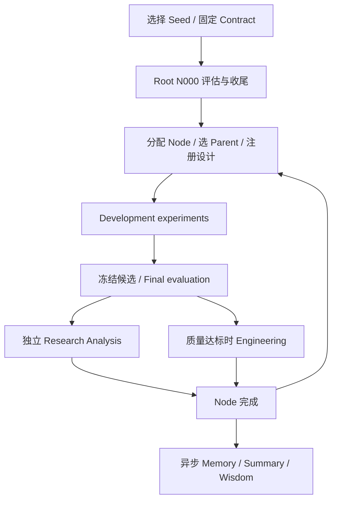

# CORAL AutoResearch 架构：GreedyLoRE 与 ARC-TopK Seed

更新：2026-11-02，依据仓库实现 `64aa372`。本文介绍共享 AutoResearch 系统的职责和边界；任务目录仍名为 `tasks/greedylore_autoresearch/`。保存过的 Run 按自身配置、Contract 和代码快照解释，修改仓库不会自动更新正在运行的实验。

## 阅读入口

| 想了解什么 | 文档 |
| --- | --- |
| 选 Seed、推进研究、理解评估和预算 | [工作流与评估协议](greedylore-autoresearch-workflow.md) |
| 找代码、研究档案、结果和清理后的证据 | [产物与保存规则](greedylore-autoresearch-artifacts.md) |
| 理解身份、资源视图、诊断、等待和恢复 | [运行时与资源访问](greedylore-runtime-reliability-design-20261029.md) |
| 查阅历史验证范围和归档 | [历史验证索引](greedylore-runtime-reliability-validation-20261029.md) |
| 准备运行及查询具体操作 | [任务 README](../tasks/greedylore_autoresearch/README.md)、[Researcher 命令](../tasks/greedylore_autoresearch/references/research_commands.md)、[Engineer 命令](../tasks/greedylore_autoresearch/references/engineer_commands.md) |

## 1. 系统分工

CORAL 提供 Agent 进程、Git worktree、正式 Attempt、grader 队列、可信命令和共享状态。任务包在其上实现研究树、分阶段开发与最终评估、独立分析、工程优化和研究记忆。

Researcher 在一个 Node 内检验核心假设并迭代设计；Analyzer 在开发冻结、最终评估终态后独立审视证据；Engineer 从固定 Research SHA 做保持算法语义的实现优化，并自行提交 Engineering Analysis；Memory 整理跨节点认识。Research Analysis 与 Engineering 可以并行，二者按规则收尾后 Node 才能成为 Parent。

研究共同目标是通过有学术新意的方法与科学认识改善质量—成本权衡。优先考虑低秩、稀疏化方向以及新的方法和机制；组合与自适应方法需说明互补性、决策依据、状态和成本。这些偏好不替代角色的独立判断，也不要求每个节点产生新发现。共同目标由 [shared_research_goal.md](../tasks/greedylore_autoresearch/prompts/shared_research_goal.md) 提供，角色规则由任务的 `roles/`、`prompts/` 和 `references/` 承担。

## 2. Seed 与固定协议

当前支持两个声明式 Seed：GreedyLoRE 和 ARC-TopK。二者使用共享模型、数据流、优化器、编排和评估协议；ARC-TopK 接入的是压缩算法及必要适配，不表示复现其上游训练配方，也不表示可接入任意原生仓库。

| 入口 | Contract 与用途 |
| --- | --- |
| [task_greedylore.yaml](../tasks/greedylore_autoresearch/task_greedylore.yaml) | v5，显式声明 GreedyLoRE 身份、来源与初始方法 |
| [task_arctopk.yaml](../tasks/greedylore_autoresearch/task_arctopk.yaml) | v5，声明 ARC-TopK 身份及导入来源 |
| [task.yaml](../tasks/greedylore_autoresearch/task.yaml) | 保留原 GreedyLoRE v4 入口 |

v5 延续 v4 的固定训练与测时预算，增加 Seed 声明及受限方法参数处理。语言、vision 和 timing 使用共同的 hook 构造入口，防止各任务执行不同方法。Seed 身份、Root 描述、Contract 和来源哈希在准备 Run 时固定；恢复及 Engineering 验证读取保存的私有 Contract。v1–v4 的历史哈希与解释保持原样，新 Seed 不能直接沿用旧 Contract 的 Dense/Root 分数。

主要实现：[prepare_seed_run.py](../tasks/greedylore_autoresearch/scripts/prepare_seed_run.py)、[bootstrap.py](../tasks/greedylore_autoresearch/autoresearch/src/autoresearch/bootstrap.py)、[compression.py](../tasks/greedylore_autoresearch/grader/src/greedylore_autoresearch_grader/compression.py)。

## 3. 研究树与调度

一个 Node 对应一个核心研究假设，开发轨迹和普通 Git commit 不各自创建 Node。普通节点注册 `origin + design`，固定一个 Parent、其 Research SHA、研究模式、证据和初始设计；后续设计及观察追加到宿主管理的研究档案。核心假设改变需要另建 Node。Root `N000` 的来源和候选由 bootstrap 固定，不走普通选题与开发循环。

Parent 必须已经完成 Research Analysis 和 Engineering，或按宿主规则明确跳过 Engineering。质量失败节点仍可产生有信息的 Analysis，完成后可供后续研究引用。Child 从 Parent 的固定 Research SHA 出发；Engineering SHA 和 Analysis 可供研究参考，不替换 Research 继承基点。当前没有集中式 MCTS/UCT 选点公式。

当前任务以 `max_active_nodes: 2` 限制未完成 Node 数量。一个 Node 跨 Research、Analysis 和 Engineering 持有同一名额；Researcher 退休不释放名额，整个 Node 完成才释放。此模式下独立的 Researcher/Engineer 数量配置不再决定准入。恢复旧积压时优先推进较早的 Node，后续节点保留代码、会话和预算并等待。

`WorkflowStore.reconcile()` 生成 assignment roster，CORAL Manager 据此启动、恢复或退休生产 Agent；可信 dispatch filter 在正式执行前再次核验准入。各 Node 的 Research Analysis 可并行，Memory 使用独立的串行队列。常规调度信任宿主记录的完成状态并检查 canonical 报告存在性，复用本次 reconcile 的准入结果；发布、Parent 选择、显式完成检查和 checkpoint 删除仍做完整证据校验。报告内容改动在这些边界检测，缺失或符号链接报告则继续占用名额。

主要实现：[state.py](../tasks/greedylore_autoresearch/autoresearch/src/autoresearch/state.py)、[lifecycle.py](../tasks/greedylore_autoresearch/autoresearch/src/autoresearch/lifecycle.py)、[dynamic.py](../coral/agent/dynamic.py)、[manager.py](../coral/agent/manager.py)。

## 4. 执行、评估与可信发布

生产 Agent 在独立 worktree 中工作，Codex 的任务入口写入生成的 `AGENTS.md`，链接角色文件和公开 toolkit。Researcher/Engineer 的进程恢复沿用原身份与会话；Analyzer 使用独立会话和固定代码/证据输入。当前任务关闭通用 heartbeat，动态工作流仅支持单岛。

Agent 通过 `autoresearch` 与 `coral eval` 等既有入口请求操作。宿主根据已登记进程身份验证 assignment、阶段、候选 SHA、固定 anchor 和预算。私有状态、评分记录和正式产物由可信入口维护；生产 Agent 不直接改权威研究树。正式 grader 在固定 commit 的隔离 checkout 中运行；分阶段 Research 控制器管理开发训练、诊断和冻结后的最终组件，使用同一固定 Contract 与评估实现。

Researcher 持有的四卡 reservation 从 GPU 开发阶段延续至最终评估全部终态或明确跳过，各子任务串行借用。独立 Research Analysis 与 Engineering 使用各自受控执行入口和预算。具体排队、恢复及等待规则见运行时文档。

主要实现：[trusted_writes.py](../coral/grader/trusted_writes.py)、[submission.py](../tasks/greedylore_autoresearch/autoresearch/src/autoresearch/submission.py)、[staged_research.py](../tasks/greedylore_autoresearch/autoresearch/src/autoresearch/staged_research.py)、[staged_execution.py](../tasks/greedylore_autoresearch/autoresearch/src/autoresearch/staged_execution.py)、[任务 grader](../tasks/greedylore_autoresearch/grader/src/greedylore_autoresearch_grader/grader.py)。

## 5. 分析、记忆与可观测性

Research Analysis 区分机制解释、竞争解释、实际收益及未知，形成有证据范围的认识和后续研究问题。Engineer 的最终 Analysis 覆盖本 assignment 的全部正式候选、语义检查、性能归因和停止原因；不再启动独立 Engineering Analyzer。宿主封存证据，发布完整 JSON 和便于阅读的 Markdown 视图，并生成 handover。

Node 完成后异步触发 Memory，串行更新 `research_summary.md`、`engineering_summary.md` 和 `wisdom.md`。Summary 提供结果导航，Wisdom 保存可复用认识、反例、适用边界及版本化来源。它们的覆盖记录不等于每次重新检查全部历史，Memory 发布不阻塞 Node 完成。

状态以文件和 Git 持久化。`tree.md`、节点 README、`evaluation.md` 是派生视图；原始 Attempt、执行记录、Contract 和固定 Git SHA 用于核实事实，Analysis 在这些事实之上解释。通用 Dashboard 的 Git Attempt DAG 与任务的 Parent 研究树不同，`improved` 标签也不等于质量门槛通过。

主要实现：[analysis.py](../tasks/greedylore_autoresearch/autoresearch/src/autoresearch/analysis.py)、[engineering.py](../tasks/greedylore_autoresearch/autoresearch/src/autoresearch/engineering.py)、[memory.py](../tasks/greedylore_autoresearch/autoresearch/src/autoresearch/memory.py)、[navigation.py](../tasks/greedylore_autoresearch/autoresearch/src/autoresearch/navigation.py)、[web API](../coral/web/api.py)。
